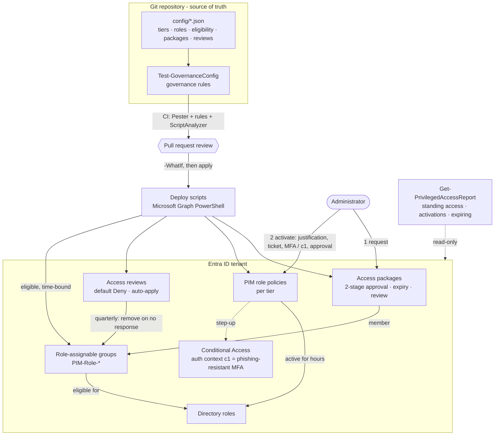

# Entra ID Privileged Access Governance as Code

**Zero standing admin access for a Microsoft 365 / Entra ID tenant. Admin roles are *eligible*, not assigned.
People activate them just in time with MFA or phishing-resistant authentication, a justification, a ticket and a time
limit. Tier 0 also needs approval. Eligibility itself is requested through access packages and re-certified by recurring
access reviews. All of it is defined in JSON, validated in CI and deployed with Microsoft Graph PowerShell.**

> **Provenance.** This is a portfolio reference implementation of the privileged-access model I designed and operate as a
> Senior Systems Specialist (PIM just-in-time access for Entra ID and Azure roles, access packages and access reviews).
> **No employer configuration, tenant IDs, group names or data are included.** All names are fictional (`contoso.example`).
> The Entra role template IDs and Azure built-in role IDs are Microsoft's public, tenant-independent values.

## Architecture



How access works for an administrator:

1. **Become eligible**: request the access package (for example *Intune Administrator (eligible)*). The manager approves, then the Tier 1 approver group, and membership expires after 180 days.
2. **Activate when needed**: in PIM (or with `Request-RoleActivation.ps1`), with a justification and ticket number, for at most 8 h (Tier 1). Tier 0 needs approval and the `c1` authentication context.
3. **Re-certify**: a quarterly access review of the role group. If no one answers, access is removed.

## Tier model

| Tier | Roles (examples) | Max activation | Approval | Authentication | Ticket | Eligibility max |
|---|---|---:|---|---|---|---:|
| **0** Control plane | Global Admin, Privileged Role Admin, Privileged Auth Admin, Conditional Access Admin, Security Admin | **2 h** | **Yes**, Tier 0 approver group | Auth context `c1` (phishing-resistant) | Yes | 180 d |
| **1** Workload admin | Exchange, Intune, SharePoint, User, Authentication, Application Admin | 8 h | No | MFA | Yes | 365 d |
| **2** Support / read | Helpdesk Admin, Global Reader | 8 h | No | MFA | No | 365 d |

Two cloud-only break-glass accounts are the **only** permanent role holders. They are excluded from Conditional Access, they use FIDO2 keys kept in a safe, and every sign-in raises an alert ([docs/break-glass.md](docs/break-glass.md)).

## Governance rules enforced in CI

`Test-GovernanceConfig` fails the build if a change would:

- let any activation last more than 8 h, or Tier 0 more than 4 h,
- drop justification, or allow activation without MFA or an authentication context,
- remove approval or the authentication context from Tier 0,
- make eligibility longer than the tier limit, or leave a role with no eligibility rule or no recurring review,
- leave an access package with no expiry (365 d max), no review, review "keep access on no response", or a single approval stage on a privileged package,
- give guests more than 90 days or review them less often than monthly,
- set an access review default decision to **Approve**, or turn off auto-apply,
- document fewer than two break-glass accounts.

## Repository layout

```
config/pim-role-settings.json      tiers, roles (public template IDs), break-glass accounts
config/eligible-assignments.json   role -> role-assignable group, eligibility length
config/access-packages.json        catalogs, packages, approval stages, expiry, reviews
config/access-reviews.json         role, group and guest reviews
modules/EntraGovernance/           validators, Graph body builders, Graph helpers
scripts/Test-GovernanceConfig.ps1      offline rule check (CI)
scripts/Set-PimRoleSettings.ps1        PIM policy rules per role          (-WhatIf)
scripts/Set-EligibleAssignments.ps1    eligible schedules + standing-access drift check
scripts/Deploy-AccessPackages.ps1      catalogs, resources, packages, policies
scripts/Deploy-AccessReviews.ps1       recurring review definitions
scripts/Request-RoleActivation.ps1     JIT self-activation with justification/ticket
scripts/Set-AzureRbacEligibility.ps1   same model for Azure subscription roles (ARM PIM API)
scripts/Get-PrivilegedAccessReport.ps1 monthly read-only report
tests/EntraGovernance.Tests.ps1        Pester: rules (16 negative cases) and request bodies
```

## Quick start

```powershell
./scripts/Test-GovernanceConfig.ps1                       # offline, no tenant needed
Invoke-Pester ./tests

Connect-MgGraph -Scopes RoleManagementPolicy.ReadWrite.Directory,RoleEligibilitySchedule.ReadWrite.Directory,`
    RoleAssignmentSchedule.Read.Directory,EntitlementManagement.ReadWrite.All,AccessReview.ReadWrite.All,Group.Read.All
./scripts/Set-PimRoleSettings.ps1 -WhatIf                 # always preview first
./scripts/Set-EligibleAssignments.ps1 -Justification 'Governance sync CHG0000000' -WhatIf
./scripts/Deploy-AccessPackages.ps1 -WhatIf
./scripts/Deploy-AccessReviews.ps1 -WhatIf
```

Requires PowerShell 7.2+ and `Microsoft.Graph.Authentication`. Deploy in a test tenant first. The validators and
Pester tests run in CI without any tenant. The deploy scripts call live Graph endpoints and have not been run against
a tenant from this repository.

## Documentation

| Document | Contents |
|---|---|
| [Architecture](docs/architecture.md) | Components, identity flows, design decisions |
| [PIM design](docs/pim-design.md) | Tiering rationale, policy rules, Conditional Access authentication context |
| [Entitlement management](docs/entitlement-management.md) | Catalogs, packages, approval chains, guest lifecycle |
| [Access reviews](docs/access-reviews.md) | What is reviewed, by whom, how often, what happens on no response |
| [Break-glass accounts](docs/break-glass.md) | Emergency access design, monitoring, test procedure |
| [Graph permissions](docs/graph-permissions.md) | Least-privilege scopes per script |
| [Deployment runbook](docs/deployment-runbook.md) | Order of operations, rollback, monthly operations |

## Skills shown

Microsoft Entra ID · Privileged Identity Management (Entra and Azure resource roles) · entitlement management · access reviews · Conditional Access authentication contexts · zero standing privilege · identity governance as code · Microsoft Graph API · PowerShell 7 · Pester · CI
