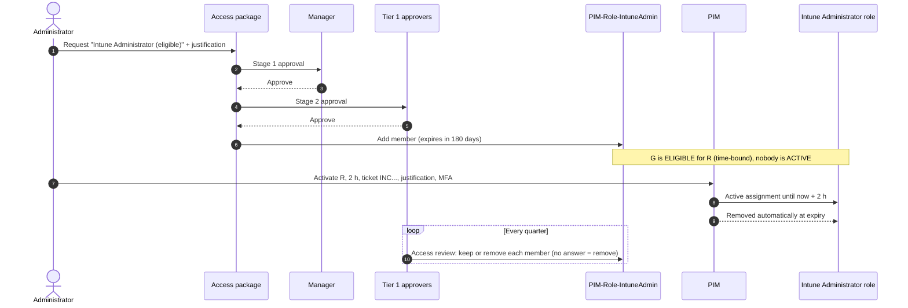

# Architecture

## Layers

| Layer | Object | Purpose |
|---|---|---|
| Request | Access package (entitlement management) | One standard way to ask for access, with approval, expiry and review built in |
| Eligibility | Role-assignable security group `PIM-Role-*` | Holds the people who *may* activate a role. Membership comes only from the access package |
| Activation | PIM policy for the directory role | Rules for turning eligibility into a time-limited active assignment |
| Step-up | Conditional Access authentication context `c1` | Requires phishing-resistant MFA (FIDO2 / Windows Hello / certificate) when a Tier 0 role is activated |
| Re-certification | Access reviews | Removes eligibility that is no longer justified |
| Evidence | Audit log + `Get-PrivilegedAccessReport` | Who was eligible, who activated what, when and why |

## Lifecycle of privileged access

## Why groups between packages and roles

- **One PIM eligibility per role, not per person.** People join and leave the group, and the PIM config stays the same.
- **Access packages can grant groups** but not directory-role eligibility directly. Role-assignable groups connect the two.
- **Role-assignable groups are protected.** Only Privileged Role Administrators and the group owners can change membership, so a User Administrator cannot add themselves.

## Design decisions

| Decision | Alternative | Reason |
|---|---|---|
| JSON config + PowerShell deploy | Click-ops in the portal | Reviewable changes (pull requests), repeatable across tenants, evidence of intent for auditors |
| Validation rules in code, run in CI | Rely on reviewers to notice | Weak settings (8 h → 24 h, Approve as default) are rejected automatically, before anyone deploys |
| Resolve group names at deploy time | Store object IDs | Same config works in test and production tenants; no tenant identifiers in Git |
| `-WhatIf` on every write | Separate plan tool | Native PowerShell, so the preview and the change use the same code path |
| Authentication context for Tier 0 instead of "MFA" | PIM's built-in MFA rule | PIM MFA accepts any MFA method; the CA authentication context can demand phishing-resistant strength |
| Two approval stages for privileged packages | Manager only | The manager knows the job; the approver group knows the risk |
| Default decision Deny + auto-apply | Leave unanswered reviews in place | A review nobody answers otherwise keeps every grant |
| Azure roles through the same model | Separate process | One mental model and one report for every kind of administrator access |

## What lives outside this repository

- The Conditional Access policy that maps authentication context `c1` to the phishing-resistant authentication strength (kept with CA policies).
- Break-glass account creation and FIDO2 key custody (a manual, documented procedure; see [break-glass.md](break-glass.md)).
- Alert rules for break-glass sign-ins and Tier 0 activations (SIEM).
