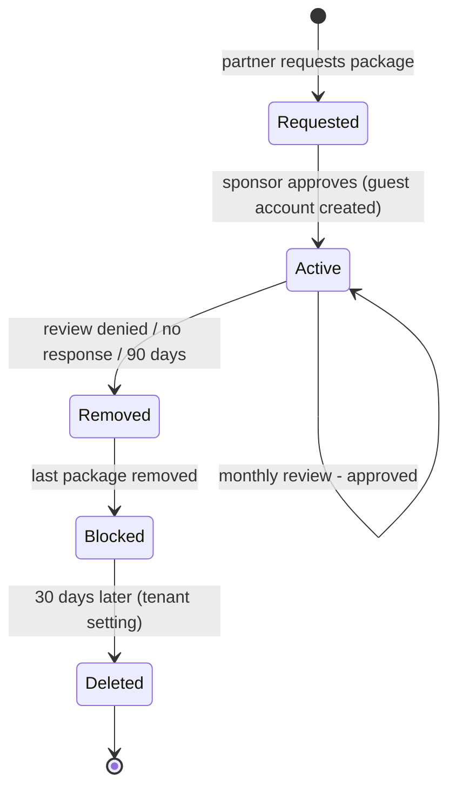

# Entitlement Management

## Catalogs

| Catalog | Contents | Who manages it | External |
|---|---|---|---|
| IT Privileged Access | `PIM-Role-*` role-assignable groups | IAM team | No |
| Business Applications | Application security groups (ERP, finance) | Application owners as catalog owners | No |
| Partner Collaboration | Groups and sites shared with partners | Partner sponsors | Yes |

## Package policy pattern

| | Privileged | Business application | Partner (guest) |
|---|---|---|---|
| Who can request | Members of the IT team group | Any employee | Users from connected organisations |
| Approval | **Manager → approver group** (two stages) | Manager | Sponsor group |
| Approval timeout | 2 days, then denied | 3 days | 3 days |
| Assignment expiry | 180 days | 365 days | **90 days** |
| Access review | Quarterly by approver group | Semi-annual by manager | **Monthly** by sponsors |
| No response | Remove access | Remove access | Remove access |
| Self-review allowed | No | No | No |

## Guest lifecycle

Tenant settings that go with this: *external user lifecycle*, which blocks sign-in when the last assignment is removed
and deletes the account after 30 days. Guest invitations are limited to the entitlement-management flow.

## Separation of duties

Incompatible packages (for example *Finance ERP - Accounts Payable* and *Finance ERP - Vendor Master*) can be marked
incompatible in entitlement management. A user who holds one cannot request the other. Add the pairs to the package
config as the business defines them.
